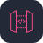
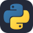

<h1 align="center">Guilherme Boeira Damasio</h1>
<h3 align="center">Backend Software Engineer · Node.js / TypeScript · PHP · AWS Serverless & Event-Driven Architecture</h3>

  <a href="https://portfolio.devdek.online" target="_blank"><b>portfolio.devdek.online</b></a>

  &nbsp;
  &nbsp;
  &nbsp;
  

### About

Backend engineer based in Joinville, Brazil, working on systems that have to stay up and stay correct under load.

- **Now:** APIs in **Node.js (Express, NestJS) with TypeScript** for a vehicle tracking and fleet management platform — an **event-driven pipeline on SQS/SNS that processes millions of tracker positions per day**, with async processing and resilient reprocessing. **AWS Lambda** for asynchronous workloads and integrations, **IoT devices** and third-party systems, and the services running on **Kubernetes (EKS/Rancher)** with their GitHub Actions deploy pipelines.
- **Before:** ~2 years on **PHP** in a LIMS platform, implementing critical calculation routines with **DDD and Clean Architecture** and taking test coverage from **10% to 40%** with PHPUnit while refactoring legacy modules.
- **Learning in public:** **applied AI** — LLM integrations, RAG and **MCP servers**. [docsage](https://github.com/Guilherme-b-damasio/docsage) is where that goes.

What I care about: clear boundaries, tests that mean something, observability before the incident, and code the next person can read.

---

### Featured: docsage

> **Ask questions about your own documents** — a RAG CLI and MCP server in Python, built with Claude.

[**docsage**](https://github.com/Guilherme-b-damasio/docsage) indexes Markdown, text, HTML, Word and PDF files (and web pages by URL), retrieves the most relevant passages and asks Claude for an answer that **cites its sources** — down to the heading path or the PDF page.

- **Retrieval you can tune:** BM25, local embeddings (sentence-transformers) or **hybrid** with reciprocal rank fusion, plus optional **re-ranking by Claude**
- **Measured, not guessed:** `docsage evaluate` reports recall@k on labeled queries; every result explains its score term by term
- **MCP server** (stdio and HTTP) so Claude Code and Claude Desktop can search your docs, with **MCP Apps** HTML reports showing highlighted citations
- Incremental indexing, prompt caching, token usage and cost per answer, English and Portuguese aware
- Clean Architecture (domain / application / infrastructure / interfaces), SOLID, **460+ tests**, CI with ruff and mypy, git flow

`Python` · `Claude API` · `MCP` · `BM25` · `sentence-transformers` · `pytest`

### What I've Built

#### DevDek — a collectible card game built on the Joinville tech scene

Devs sign in with GitHub and become a character card made of their own stats — languages as powers, activity, badges. Companies are checkpoints on a 3D map: get physically close to one and you earn its badge card. Two separate codebases, private for now — see it at [portfolio.devdek.online](https://portfolio.devdek.online).

| Project | What I did | Stack |
| --- | --- | --- |
| **DevDek — Backend** | The API and the game rules: GitHub OAuth issuing JWTs, card generation rendered server-side to images, **real-time card battles over WebSockets**, geolocation check-ins against curated company checkpoints, community submissions with a moderation flow, and logo delivery through Cloudflare R2. Migrated persistence from Mongoose/MongoDB to **Prisma/PostgreSQL**. Battle rules are covered by simulation scripts that check invariants across thousands of generated duels. | `NestJS` · `TypeScript` · `Prisma` · `PostgreSQL` · `Socket.IO` · `Passport (GitHub OAuth, JWT)` · `Satori/resvg` · `Cloudflare R2` · `Docker` |
| **DevDek — Mobile** | Android app on **Expo** with expo-router, consuming the same API as the web client. GitHub OAuth through a system browser tab with a `devdek://` deep link back (no embedded WebView — GitHub blocks OAuth there, and the user needs to see the address bar), secure token storage, card collection with filters, native MapLibre map, GPS check-ins, camera-based QR and 3D rendering with react-three-fiber. | `React Native` · `Expo` · `TypeScript` · `expo-router` · `MapLibre` · `react-three-fiber` · `expo-location` · `expo-secure-store` · `Socket.IO` |

#### Open source

| Project | What it is | Stack |
| --- | --- | --- |
| [**docsage**](https://github.com/Guilherme-b-damasio/docsage) | RAG over your own documents: CLI and MCP server that index Markdown, HTML, Word, PDF and web pages, retrieve with BM25 / embeddings / hybrid search and answer with Claude, citing the sources. | `Python` · `Claude API` · `MCP` · `sentence-transformers` |
| [**Asaas Payment Gateway for Bagisto**](https://github.com/Guilherme-b-damasio/AsaasApiBagisto) | Two complementary packages integrating the Asaas gateway into Bagisto — PIX, boleto and credit card — exposing REST endpoints and handling payment webhooks (`PAYMENT_CONFIRMED`, `PAYMENT_RECEIVED`, `PAYMENT_REFUNDED`). | `PHP 8.1+` · `Laravel` · `Bagisto` · `REST API` · `Webhooks` |
| [**VulnUI**](https://github.com/Guilherme-b-damasio/vulnui) | Dashboard that orchestrates **OWASP ZAP** and **Nikto** scans from a single interface: spider crawling, active scanning, real-time progress and report history with risk categorization. | `Next.js 15` · `TypeScript` · `Tailwind CSS 4` · `Docker` |
| [**vuln.ai**](https://github.com/Guilherme-b-damasio/vuln.ai) | The scanning engine behind VulnUI — a Python orchestrator that drives the ZAP API and the Nikto CLI and consolidates the findings. | `Python` · `OWASP ZAP API` · `Nikto` |

---

## Tech Stack

<table>
  <tr>
    <td><b>Core</b></td>
    <td>       </td>
  </tr>
  <tr>
    <td><b>Cloud & Serverless</b></td>
    <td>      </td>
  </tr>
  <tr>
    <td><b>Applied AI</b></td>
    <td>    </td>
  </tr>
  <tr>
    <td><b>Databases</b></td>
    <td>     </td>
  </tr>
  <tr>
    <td><b>DevOps & Infrastructure</b></td>
    <td>      </td>
  </tr>
  <tr>
    <td><b>Observability & Testing</b></td>
    <td>      </td>
  </tr>
</table>

<b>Also worked with</b>

 

       

